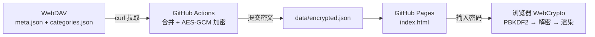

# 欧阳的收藏夹 · Bookmark Vault

> 一个把私有书签「加密托管」在 GitHub Pages 上的只读查看器。
> 数据来自 WebDAV，本站不采集、不上传、不写回任何内容。

当前版本 **v2.0.0**

---

## 这是什么

书签平时存在自己的 WebDAV 目录里（由 HamHome 之类的工具同步）。本项目通过 GitHub Actions 手动触发一次拉取，把书签与分类合并后 **在 CI 里加密**，只把密文 `data/encrypted.json` 提交进仓库；GitHub Pages 托管一个纯静态页面，浏览器里输入密码后 **在本地解密并渲染**。

结果就是：站点是公开的，内容却不是——没有密码的人只会看到一个密码框。

## 功能特性

- **密码门 + 本地解密**：AES-256-GCM，密钥由 PBKDF2-HMAC-SHA256 派生，解密全部在浏览器 WebCrypto 内完成，密码不上传、不落盘（仅存 localStorage 便于自动登录）
- **抽屉式筛选**：左侧滑出抽屉，分类按 `/` 自动拆成两级目录（可折叠、可整组筛选），标签支持搜索 + 展开全部
- **书签明细页**：点击卡片进入全屏明细（`#/b/<id>` 路由，支持返回键、可单独收藏），展示完整标题、完整描述、完整网址、分类与全部标签
- **双跳转入口**：卡片右下角 `↗` 直接打开原站；明细页底部主按钮「打开网站」+ 次按钮「复制链接」
- **搜索**：标题 / 网址 / 描述 / 标签四字段匹配，120ms 防抖，筛选条件以 chip 形式常驻顶栏可单独移除
- **暗色科幻视觉**：蓝黑配色、网格底纹、等宽字体元信息、卡片扫光与入场动效；全部动效均支持 `prefers-reduced-motion` 降级
- **响应式**：1 / 2 / 3 列自适应，移动端安全区适配

## 交互模型

```
主界面（卡片网格）
 ├─ 点击卡片任意位置 ─────→ 明细页 ──「打开网站」──→ 原站
 ├─ 点击卡片右下角 ↗ ─────────────────────────────→ 原站
 └─ 点击顶栏 ☰ ──────────→ 筛选抽屉（分类 / 标签）
```

## 架构与数据流



## 目录结构

```
.
├── index.html               # 单文件应用：样式 + 逻辑 + 视图
├── data/
│   └── encrypted.json       # 唯一数据文件（密文，v/salt/iv/ct）
├── .github/workflows/
│   └── sync.yml             # 手动触发的同步 + 加密流水线
└── README.md
```

## 部署与配置

在仓库 **Settings → Secrets and variables → Actions** 中配置四项：

| Secret | 说明 |
|---|---|
| `WEBDAV_URL` | WebDAV 基础地址（不含路径） |
| `WEBDAV_USER` | WebDAV 用户名 |
| `WEBDAV_PASS` | WebDAV 密码 |
| `BOOKMARK_PASSWORD` | 站点访问密码，同时用于加密 |

Pages 侧：**Settings → Pages → Source: Deploy from a branch → main / (root)**。

## 同步方式（手动）

进入 **Actions → Sync bookmarks from WebDAV → Run workflow**。

流水线会依次：拉取两个 JSON → 校验非空且形如 JSON → 合并为 `{bookmarks, categories, updatedAt}` → 加密写入 `data/encrypted.json` → 若有变化则自动提交。

> 已刻意**不配置定时任务**：数据只在需要时手动刷新，避免无意义提交与噪音历史。
> 流水线日志只打印条目数量，不打印任何书签内容。

## 安全模型

| 层 | 做法 |
|---|---|
| 传输 | 全站 HTTPS（GitHub Pages） |
| 存储 | 仓库内只有密文；明文 `meta.json` 从不提交（历史提交核查为 0 次） |
| 加密 | PBKDF2-SHA256（100,000 次迭代）派生 256 位密钥，AES-GCM 加密，12 字节随机 IV |
| 解密 | 浏览器本地 WebCrypto，密码仅保存在本机 localStorage |
| 凭据 | WebDAV 账号密码与站点密码均为 GitHub Secrets，不进代码 |

定位是「**防止随手浏览**」，不是抵御有动机的攻击者。真正需要保密的是 WebDAV 凭据——它只存在于 Secrets 中。

## 数据结构

`data/encrypted.json` 解密后：

```json
{
  "bookmarks": [
    {
      "id": "string(21)",
      "url": "https://example.com",
      "title": "标题",
      "description": "描述文本",
      "categoryId": "分类 id 或 null",
      "tags": ["标签1", "标签2"],
      "favicon": "https://...",
      "hasSnapshot": true,
      "createdAt": 1791984285341,
      "updatedAt": 1791984331343,
      "isDeleted": false
    }
  ],
  "categories": [{ "id": "string(21)", "name": "一级/二级" }],
  "updatedAt": "2026-11-03T05:25:43+00:00"
}
```

前端会过滤 `isDeleted`，并把含 `/` 的分类名渲染为两级目录。

## 本地预览

```bash
python -m http.server 8000
# 打开 http://localhost:8000
```

必须通过 `localhost` 或 HTTPS 访问——`crypto.subtle` 仅在安全上下文可用，用局域网 IP 走 http 会解密失败。

## 更新记录

### v2.0.0 — 2026-11-03
- 全站视觉重做：蓝黑科幻配色、网格底纹、等宽字体元信息、卡片扫光与入场动效
- 新增书签明细页，支持 `#/b/<id>` 路由、返回键、单条收藏
- 卡片改为「点击看明细 + 右下角 ↗ 直接跳转」双入口
- 分类与标签筛选改为左侧抽屉：分类两级目录、标签搜索与展开全部
- 使用书签自带的 `favicon` 字段显示真实网站图标
- 顶部新增筛选状态回显（可单独移除的条件 chip）
- 键盘支持：`/` 聚焦搜索、`Esc` 关闭抽屉或明细

### v1.0.0 — 2026-10-16
- 初版：密码门、卡片网格、分类与标签筛选、搜索、WebDAV 同步 + AES-GCM 加密
